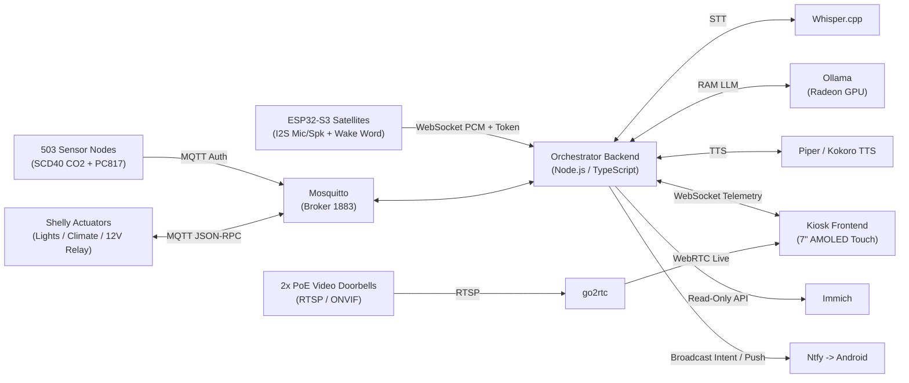

# VEXIS Smart Home (`vexis-smart-home`)

> A **100% local, open-source, Zero-Cloud** smart home, self-hosted homelab, and AI voice assistant.

[Italiano](README.md) · **English**  
[**1. Features**](#1-features) · [**2. Hardware**](#2-hardware) · [**3. Software**](#3-software) · [**4. Extras**](#4-extras)

---

**Vexis** is built to deliver a responsive, AI-powered smart home **with zero external cloud dependencies** (no Shelly Cloud, no Google Home, no proprietary apps):
- **100% Local:** STT, LLM, TTS, automations, video intercom, photos, and media all run strictly on your home server.
- **Physical Privacy & Security:** No motorized smart locks on armored deadbolts; armored doors are monitored via passive isolated sensors (`PC817` optoisolator / microswitch), and the existing 12V electric latch is controlled exclusively **from inside the house**.
- **Vexis Identity:** Local wake word `Vexis` (+ immediate stop/barge-in), dry analytical slightly cynical/mecha tone (*Chatty Stick* / *EDI* style), and a minimalist optical HUD on pure AMOLED black.

---

## 1. Features

### Home Automation & Climate
- **Lights & Rooms:** Instant control via voice, AMOLED Kiosk touch UI, or wired 230V wall push-buttons connected to Shelly relays over local MQTT JSON-RPC.
- **Climate Control:** Dry-contact boiler and chiller control based on environmental sensors (`Shelly BLU H&T` and `SCD40`), with software/hardware fail-safes.
- **Alarm-to-Light Sync:** Automatically links morning alarms to scheduled or gradual wake-up lighting.

### Air Quality Monitoring (True NDIR CO₂)
- **Continuous Sensing:** Real-time CO₂ (`ppm`), temperature, and humidity readings via `Sensirion SCD40` sensors.
- **Targeted Voice Alerts:** Spoken warning exclusively on the affected room's satellite above `1200–1300 ppm`, with a 30-minute anti-spam cooldown and immediate override on critical spikes (`>1600 ppm`).
- **HUD Indicator:** Dynamic green / amber / red status badge on the AMOLED dashboard and satellite display.

### Multi-Room Voice Interaction & HUD UX
- **5-Room Coverage & Anti-Echo Arbitration:** 5 flush-mounted `ESP32-S3` satellites hidden inside unused Italian `503` wall-box slots (zero visible cables); when adjacent rooms hear the wake word simultaneously, the backend arbitrates within ~250 ms and picks the strongest signal. Includes a **room-to-room intercom** feature.
- **Dual Wake Word & Barge-In:** Local `ESP32-S3` detection for `Vexis` + an instant stop word to interrupt long replies or active TTS playback.
- **Anti-Context-Rot Memory:** Ephemeral stateless per-room LLM sessions (sliding window max 3 turns, 45–60s TTL) with live MQTT home state injected into every prompt.
- **AMOLED Optical Visualizer:** Pure `#000000` UI with a reactive central optical core (`IDLE`, `LISTENING`, `THINKING`, `SPEAKING`).

### Local Video Intercom (2 Armored Doors)
- **Dual Independent Entrances (`door_1` / `door_2`):** Instantly identifies which door rang, triggering targeted voice announcements on the `ESP32-S3` satellites.
- **Live Stream & Push Alerts:** Automatically opens a temporary live video modal on the 7" AMOLED Kiosk via `go2rtc` (low-latency WebRTC, `60–90s` auto-dismiss) and sends a snapshot push notification to Android via `Ntfy`.
- **Protected Door Release:** The existing 12V electric latch can only be triggered from inside (Kiosk button / indoor physical switch) via an indoor dry-contact relay—never exposing lock wiring outside and never allowing unauthenticated voice unlocking.

### Android Integration & Guest Access
- **Voice Alarms (Zero Open Ports):** Natural-language commands (e.g., *"set an alarm for 6:30"* or *"I have the morning shift tomorrow"*) pushed via **Ntfy** as native Android Broadcast Intents (`android.intent.action.SET_ALARM` with `SKIP_UI: true`).
- **Links & Navigation:** Send Google Maps routes, reminders, or urgent alerts straight to Android.
- **Dynamic Guest QR Code:** Temporarily displays Guest Wi-Fi credentials or a short-lived scoped JWT limited strictly to common-area lights (`IDLE` → `LISTENING` → `EXECUTING` → `TEMPORARY_MODAL`, `60–90s` auto-dismiss).

### Homelab & Media Control (Ollama Tools)
- **Server Diagnostics:** Voice queries for Mini PC CPU, RAM, and disk usage across NVMe and secondary storage (`get_system_storage`).
- **Semantic Photo Search (Immich):** Voice search via `/api/search/smart` (using a **read-only** API key) with temporary carousel projection on the 7" AMOLED panel.
- **Lossless Music & Voice Playlists (Jellyfin):** Personal CD collection ripped to **FLAC**, with voice-triggered playlist playback (*"Vexis, start my playlist..."*) via Jellyfin REST API to the home stereo (USB DAC / local streamer) plus album art and Play/Pause controls on the Kiosk.
- **Service Health:** Query health status of Homelab services (`Jellyfin`, `Vaultwarden`, `Immich`).

---

## 2. Hardware

| Category | Components | Role |
| :--- | :--- | :--- |
| **Server & Rack NAS** | AMD Ryzen 7 Mini PC (32 GB expandable DDR5, **Debian Stable headless**) + **4-bay USB-C 10 Gbps DAS** (JBOD: `MergerFS + SnapRAID` + `Restic/Borg` backups) + PoE Switch + UPS | Docker host, 7B–8B local LLM in RAM, media/photo storage & local backups |
| **Dedicated IoT Wi-Fi** | Dedicated Access Point in *AP Mode* (`Vexis-IoT` 2.4 GHz SSID on a separate channel) | Offloads 20–30 IoT clients from the main home Wi-Fi |
| **Lighting (230V AC)** | `Shelly Plus 2PM` / `Shelly 1PM Mini Gen3` + optional `Shelly Dimmer Gen3` (living room/bedroom with dimmable LEDs) | Zero-crossing switching, 4-step living room script & gradual dimming |
| **Climate** | `2× Shelly 1 Mini Gen3` (dry contact), `1× Shelly BLU H&T Display ZB` | Boiler/chiller control & ambient temperature sensing |
| **Wall Controls** | Wired 230V momentary push-buttons (single & dual `1P+1P`) in `503` boxes *(switch series TBD)* | Zero-battery physical control + multi-click actions via Shelly |
| **Kiosk Panel** | 7" AMOLED Touch Display (Chromium fullscreen kiosk) | HUD dashboard, CO₂ badges, photo/QR/intercom modals |
| **Satellites & Sensors (5 Rooms)** | `5× ESP32-S3` (flush-mounted in `503` with isolated `Mean Well IRM-05-5`) + `INMP441` + `MAX98357A` + `Sensirion SCD40` (+ `PC817` on doors) | All-in-one flush module: wake word, voice, intercom, NDIR CO₂ & door state |
| **Video Intercom** | `2× PoE IP Video Doorbells` *(model TBD, local RTSP/ONVIF/SIP, no NFC)* | Local video/audio for both armored entrance doors |

---

## 3. Software

### Architecture & Data Flows



### Core Stack (Docker Compose)
Orchestrated in [`docker/docker-compose.yml`](docker/docker-compose.yml) with `restart: unless-stopped` and segmented bridge networks (`vexis-core`, `vexis-media`, `vexis-proxy`):
- **Mosquitto:** Local MQTT broker on port `1883` (`allow_anonymous false`, ACLs, *Retained Messages*, *LWT*).
- **Ollama:** Local LLM runtime (`qwen2.5:7b` / `llama3.1:8b`) pinned in RAM (`OLLAMA_KEEP_ALIVE=-1`) with Radeon GPU acceleration (`/dev/kfd`, `/dev/dri`).
- **Whisper.cpp & Piper TTS:** Low-latency local Speech-to-Text and Text-to-Speech pipeline.
- **go2rtc:** Ultra-low-latency local `RTSP`/`ONVIF` → `WebRTC` video bridge to the AMOLED Kiosk.
- **Ntfy:** Self-hosted push notifications for Android intents and alerts.
- **Backend (`backend/`):** Non-root Node.js + TypeScript orchestrator with `zod` env validation, Shelly MQTT JSON-RPC bridge, authenticated WebSocket server, and Ollama tool registry.
- **Frontend (`frontend/`):** React + TypeScript + Tailwind CSS served via `nginx-unprivileged` for the AMOLED Kiosk.

<details>
<summary><strong>Repository Structure</strong></summary>

```text
vexis-smart-home/
├── .env.example               # Public environment variable template
├── .gitignore                 # Excludes secrets, MQTT passwd, Docker volumes & AI weights
├── ARCHITECTURE.md            # Technical specifications & security model
├── CONTEX.MD                  # Project design specification document
├── README.md                  # Italian documentation
├── README.en.md               # English documentation
├── docker/
│   ├── docker-compose.yml     # Unified stack (Domotics + AI + Homelab)
│   └── mosquitto/
│       ├── mosquitto.conf     # Hardened MQTT broker config (no anonymous)
│       └── acl.conf           # MQTT topic access control list
├── backend/                   # Node.js / TypeScript orchestrator
├── frontend/                  # 7" AMOLED Kiosk dashboard (React + Tailwind)
└── firmware/
    ├── satellite-esp32s3/     # PlatformIO firmware for ESP32-S3 voice satellites
    └── sensor-esp32c3/        # PlatformIO firmware for ESP32-C3 503 sensor nodes
```

</details>

### Quick Start
1. **Configure environment:** copy `.env.example` to `.env` and replace all `CHANGE_ME_*` placeholders:
   ```bash
   cp .env.example .env
   ```
2. **Generate Mosquitto credentials** (excluded from Git):
   ```bash
   docker run --rm -v $(pwd)/docker/mosquitto:/mosquitto/config eclipse-mosquitto:2.0 \
     mosquitto_passwd -c -b /mosquitto/config/passwd vexis_orchestrator "<MQTT_PASSWORD>"
   ```
3. **Start the Docker stack:**
   ```bash
   docker compose -f docker/docker-compose.yml --env-file .env up -d
   ```
4. **ESP32 Firmware:** in `firmware/satellite-esp32s3/` and `firmware/sensor-esp32c3/`, copy `include/config.h.example` to `include/config.h` and build with PlatformIO.

---

## 4. Extras

### Additional Self-Hosted Homelab Services
- **Immich:** Photo/video backup and CLIP semantic search on secondary storage (connected to Vexis via a **read-only** API key).
- **Jellyfin:** Media server for movies, TV shows, and **lossless music (FLAC + playlists)** with Radeon hardware transcoding (`/dev/dri`) and dedicated music clients (e.g. *Finamp*).
- **Vaultwarden:** Self-hosted Bitwarden-compatible password manager.
- **Nginx Proxy Manager:** Local reverse proxy (`vexis.home`, `immich.home`, `jellyfin.home`, `vault.home`), admin UI bound to `127.0.0.1:81`.
- **Portainer:** Docker container management with read-only socket mount (`:ro`).

### Security & Hardening
- Non-root application containers, zero `privileged: true` containers, strict fail-fast environment validation.
- See [`ARCHITECTURE.md`](ARCHITECTURE.md) for full details on network segmentation, MQTT ACLs, and physical privacy.

### Open Decisions & Phase 2 Brainstorming
- **230V Wall Switch Series (503):** evaluating *BTicino Living Now*, *Vimar Linea*, *Vimar Arké*, and *AVE Tekla 44* (single and dual `1P+1P` momentary push-buttons).
- **PoE Video Doorbell Model (no NFC):** evaluating *Reolink Video Doorbell PoE*, *Dahua VTO2202F-P*, and *Hikvision DS-KV8113*.
- **LED Dimming:** evaluating `Shelly Dimmer Gen3` for the living room (2 groups) and bedroom (gradual sunrise wake-up).
- **Future AI Upgrade Path:** Mini PC with user-upgradable DDR5 SO-DIMM slots (64 GB) and/or OCuLink/USB4 for larger local models (e.g., *Inkling 2 Mini* or a dedicated eGPU).
