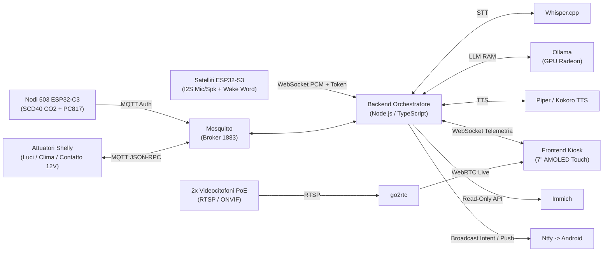

# VEXIS Smart Home (`vexis-smart-home`)

> Sistema domotico, homelab self-hosted e assistente vocale **100% locale, open source e Zero-Cloud**.

[**1. Features**](#1-features) · [**2. Hardware**](#2-hardware) · [**3. Software**](#3-software) · [**4. Extras**](#4-extras)

---

**Vexis** è progettato per offrire una casa intelligente, reattiva e gestita da un assistente AI locale **senza alcuna dipendenza da cloud esterni** (niente Shelly Cloud, Google Home o app proprietarie):
- **100% Locale:** STT, LLM, TTS, automazioni, videocitofonia, foto e media girano interamente sul server domestico.
- **Privacy & Sicurezza Fisica:** Nessuna serratura smart motorizzata sulle mandate; i portoni blindati sono monitorati con sensori passivi (`PC817` / microswitch) e l'elettroserratura 12V esistente viene gestita esclusivamente **dall'interno**.
- **Identità Vexis:** Wake word locale `Vexis` (+ stop/barge-in), tono asciutto e analitico (stile *Chatty Stick* / *EDI*) e HUD ottico minimale su nero puro AMOLED.

---

## 1. Features

### Controllo Domotico & Clima
- **Luci & Stanze:** Comando istantaneo vocale, touch (Kiosk AMOLED) o tramite pulsanti fisici 230V collegati agli Shelly via MQTT JSON-RPC.
- **Termoregolazione:** Gestione a contatto pulito di Caldaia e Chiller basata sulle sonde ambientali (`Shelly BLU H&T` e `SCD40`), con logica fail-safe.
- **Sincronizzazione Sveglia-Luce:** Collegamento automatico tra l'orario della sveglia e l'accensione programmata delle luci al mattino.

### Qualità dell'Aria (CO₂ Reale NDIR)
- **Monitoraggio Continuo:** Lettura di CO₂ (`ppm`), temperatura e umidità tramite sensori `Sensirion SCD40`.
- **Alert Vocali Mirati:** Avviso vocale sul singolo satellite della stanza interessata sopra i `1200–1300 ppm`, con cooldown anti-spam di 30 minuti e override immediato per picchi critici `>1600 ppm`.
- **Indicatore HUD:** Badge dinamico verde / ambra / rosso sulla dashboard AMOLED e sul display del satellite.

### Interazione Vocale & UX HUD
- **Doppia Wake Word & Barge-In:** Rilevazione locale su `ESP32-S3` per `Vexis` + parola di interruzione immediata per fermare risposte lunghe o TTS.
- **Memoria Anti-Context-Rot:** Sessioni stateless effimere per stanza (sliding window max 3 turni, TTL 45–60s) con iniezione live dello stato MQTT della casa ad ogni richiesta.
- **Visualizer Ottico AMOLED:** Interfaccia su nero puro `#000000` con nucleo centrale reattivo allo stato (`IDLE`, `LISTENING`, `THINKING`, `SPEAKING`).

### Videocitofonia Locale (2 Portoni Blindati)
- **Doppio Accesso Indipendente (`door_1` / `door_2`):** Riconoscimento immediato di quale dei due portoni ha suonato, con annuncio vocale mirato sui satelliti `ESP32-S3`.
- **Stream Live & Notifiche:** Apertura automatica della modale video live sul pannello AMOLED tramite `go2rtc` (WebRTC a bassissima latenza, auto-dismiss `60–90s`) + snapshot push su Android via `Ntfy`.
- **Apertura Protetta:** L'elettroserratura 12V esistente è comandabile solo dall'interno (pulsante su Kiosk / pulsante fisico) tramite contatto pulito interno, senza mai esporre fili o relè di apertura sul posto esterno e senza apertura vocale libera.

### Smartphone Android & Accesso Ospiti
- **Sveglie Vocali (Zero Porte Aperte):** Comandi in linguaggio naturale (es. *"metti una sveglia alle 6:30"* o *"domani faccio il turno di mattina"*) inviati via **Ntfy** come Broadcast Intent nativo Android (`android.intent.action.SET_ALARM` con `SKIP_UI: true`).
- **Link & Percorsi:** Invio rapido di itinerari (Google Maps), promemoria o allerte critiche sullo smartphone.
- **QR Code Ospiti Dinamico:** Proiezione temporanea sul Kiosk di credenziali Wi-Fi Guest o token JWT a scadenza con scope ristretto alle sole luci delle aree comuni (`IDLE` → `LISTENING` → `EXECUTING` → `TEMPORARY_MODAL`, auto-dismiss `60–90s`).

### Interrogazione Homelab & Media (Ollama Tools)
- **Diagnostica Server:** Controllo vocale di CPU, RAM e spazio libero su NVMe e unità secondaria (`get_system_storage`).
- **Ricerca Semantica Foto (Immich):** Ricerca vocale tramite `/api/search/smart` (API Key **read-only**) e proiezione temporanea sul pannello AMOLED.
- **Musica Lossless & Playlist Vocali (Jellyfin):** Digitalizzazione in **FLAC** della propria collezione di dischi per uso personale, con avvio vocale delle playlist (*"Vexis, avvia la playlist..."*) tramite Jellyfin REST API verso lo stereo (DAC USB / streamer locale) e controlli Play/Pausa + copertina sul pannello AMOLED.
- **Stato Servizi:** Verifica healthcheck dei servizi Homelab (`Jellyfin`, `Vaultwarden`, `Immich`).

---

## 2. Hardware

| Categoria | Componenti | Ruolo |
| :--- | :--- | :--- |
| **Server Centrale** | Mini PC AMD Ryzen 7, 32 GB RAM, NVMe primario + storage secondario, UPS | Host Docker, modelli AI in RAM e servizi Homelab |
| **Luci (230V AC)** | `1× Shelly Plus 2PM` (Sala da Pranzo), `2× Shelly 1PM Mini Gen3` (Stanze 2 e 3) | Controllo luci Zero-Crossing & telemetria consumi |
| **Clima** | `2× Shelly 1 Mini Gen3` (contatto pulito), `1× Shelly BLU H&T Display ZB` | Comando caldaia/chiller e lettura temperatura |
| **Comandi a Muro** | Pulsanti cablati 230V (NA momentanei) su scatole `503` *(serie civile in definizione)* | Controllo fisico affidabile + multi-click via Shelly |
| **Pannello Kiosk** | Schermo 7" AMOLED Touch (Chromium fullscreen) | Dashboard HUD, badge CO₂, modali foto/QR/citofono |
| **Satelliti Vocali** | `ESP32-S3` + microfono I2S `INMP441` + amp `MAX98357A` (USB-C) | Wake word locale, stream PCM e riproduzione TTS |
| **Sensori Aria & Accessi** | `ESP32-C3` + `Sensirion SCD40` (I2C) + `PC817` / microswitch (incasso 503) | CO₂ NDIR, temp/umidità e stato passivo portoni |
| **Videocitofonia** | `2× Videocitofoni IP PoE` *(modello in definizione, RTSP/ONVIF/SIP, senza NFC)* | Video/audio locale sui 2 portoni blindati |

---

## 3. Software

### Architettura & Flussi



### Stack Core (Docker Compose)
Orchestrato in [`docker/docker-compose.yml`](docker/docker-compose.yml) con policy `restart: unless-stopped` e reti bridge isolate (`vexis-core`, `vexis-media`, `vexis-proxy`):
- **Mosquitto:** Broker MQTT locale su porta `1883` (`allow_anonymous false`, ACL, *Retained Messages*, *LWT*).
- **Ollama:** LLM locale (`qwen2.5:7b` / `llama3.1:8b`) residente in RAM (`OLLAMA_KEEP_ALIVE=-1`) con GPU Radeon (`/dev/kfd`, `/dev/dri`).
- **Whisper.cpp & Piper TTS:** Pipeline locale Speech-to-Text e Text-to-Speech.
- **go2rtc:** Bridge locale `RTSP`/`ONVIF` → `WebRTC` per i due videocitofoni verso il Kiosk.
- **Ntfy:** Push notification locale verso Android.
- **Backend (`backend/`):** Node.js + TypeScript (container non-root) con validazione `zod`, bridge MQTT JSON-RPC, WebSocket autenticato e registry tool Ollama.
- **Frontend (`frontend/`):** React + TypeScript + Tailwind CSS su `nginx-unprivileged` per il Kiosk AMOLED.

<details>
<summary><strong>Struttura della Repository</strong></summary>

```text
vexis-smart-home/
├── .env.example               # Template pubblico variabili d'ambiente
├── .gitignore                 # Esclusione segreti, password MQTT, volumi e pesi AI
├── ARCHITECTURE.md            # Specifiche tecniche e modello di sicurezza
├── CONTEX.MD                  # Documento di specifica del progetto
├── README.md                  # Documentazione principale
├── docker/
│   ├── docker-compose.yml     # Stack unificato (Domotica + AI + Homelab)
│   └── mosquitto/
│       ├── mosquitto.conf     # Configurazione broker MQTT (no anonymous)
│       └── acl.conf           # Controllo accessi topic MQTT
├── backend/                   # Orchestratore Node.js / TypeScript
├── frontend/                  # Dashboard Kiosk 7" AMOLED (React + Tailwind)
└── firmware/
    ├── satellite-esp32s3/     # Firmware PlatformIO satellite vocale ESP32-S3
    └── sensor-esp32c3/        # Firmware PlatformIO nodo sensori 503 ESP32-C3
```

</details>

### Avvio Rapido
1. **Configura l'ambiente:** copia `.env.example` in `.env` e sostituisci tutti i segnaposto `CHANGE_ME_*`:
   ```bash
   cp .env.example .env
   ```
2. **Genera le credenziali Mosquitto** (file escluso da Git):
   ```bash
   docker run --rm -v $(pwd)/docker/mosquitto:/mosquitto/config eclipse-mosquitto:2.0 \
     mosquitto_passwd -c -b /mosquitto/config/passwd vexis_orchestrator "<MQTT_PASSWORD>"
   ```
3. **Avvia lo stack Docker:**
   ```bash
   docker compose -f docker/docker-compose.yml --env-file .env up -d
   ```
4. **Firmware ESP32:** in `firmware/satellite-esp32s3/` e `firmware/sensor-esp32c3/`, copia `include/config.h.example` in `include/config.h` e compila con PlatformIO.

---

## 4. Extras

### Servizi Homelab Aggiuntivi
- **Immich:** Backup e ricerca semantica foto/video su storage secondario (collegato a Vexis con API Key **read-only**).
- **Jellyfin:** Media server per film, serie TV e **musica lossless (FLAC + playlist)**, con transcodifica hardware GPU Radeon (`/dev/dri`) e supporto ad app musicali dedicate (es. *Finamp*).
- **Vaultwarden:** Gestore password self-hosted compatibile Bitwarden.
- **Nginx Proxy Manager:** Reverse proxy per i domini locali (`vexis.home`, `immich.home`, `jellyfin.home`, `vault.home`), UI admin legata a `127.0.0.1:81`.
- **Portainer:** Monitoraggio container Docker con socket montato in sola lettura (`:ro`).

### Sicurezza & Hardening
- Container applicativi non-root, nessun container `privileged: true`, validazione strict delle env all'avvio.
- Per tutti i dettagli su isolamento di rete, ACL MQTT e modello di sicurezza consulta [`ARCHITECTURE.md`](ARCHITECTURE.md).

### Idee & Decisioni Aperte (Fase 2 / Brainstorming)
- **Scelta serie civile pulsanti 230V (503):** confronto aperto tra *BTicino Living Now*, *Vimar Linea*, *Vimar Arké* e *AVE Tekla 44* (pulsanti momentanei singoli e doppi `1P+1P`).
- **Scelta modello videocitofoni PoE (senza NFC):** valutazione aperta tra *Reolink Video Doorbell PoE*, *Dahua VTO2202F-P* e *Hikvision DS-KV8113*.
- **Dock magnetica a muro** per i satelliti vocali `ESP32-S3` (rimandata a Fase 2).
