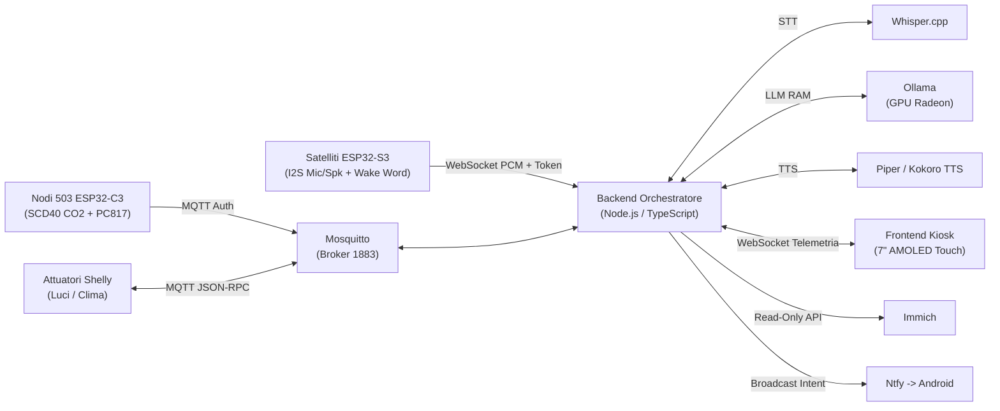

# VEXIS Smart Home (`vexis-smart-home`)

> Sistema domotico, homelab self-hosted e assistente vocale **100% locale, open source e Zero-Cloud**.

**Vexis** nasce con un obiettivo preciso: avere una casa intelligente, reattiva e dotata di un assistente vocale AI avanzato **senza alcuna dipendenza da cloud esterni** (niente Shelly Cloud, Google Home o app proprietarie) e senza compromessi sulla sicurezza fisica o sulla privacy.

---

## Principi & Filosofia

- **100% Locale & Open Source:** STT, LLM, TTS, automazioni, librerie foto e media girano interamente sul server domestico.
- **Privacy Fisica Prima di Tutto:** Nessuna serratura smart o attuatore motorizzato sugli accessi principali. I portoni blindati sono monitorati solo tramite **sensori passivi isolati galvanicamente** (microswitch sulla mandata o optoisolatore `PC817`).
- **Identità di Vexis:** Wake word locale `Vexis` (con parola di stop/barge-in immediato), tono asciutto, analitico e leggermente cinico/mecha, accompagnato da un **HUD ottico minimale su nero puro AMOLED**.
- **Anti-Context-Rot:** L'LLM non accumula conversazioni infinite che degradano la qualità delle risposte. Ogni stanza ha una **sessione effimera** (sliding window max 3 turni, TTL 45–60s) con iniezione dinamica dello stato MQTT reale ad ogni richiesta.

---

## Architettura del Sistema



---

## Hardware di Riferimento

| Componente | Modello / Specifiche | Ruolo |
| :--- | :--- | :--- |
| **Server Centrale** | Mini PC AMD Ryzen 7, 32 GB RAM, doppio storage (NVMe + secondario), UPS | Host Docker, AI locale in RAM e servizi Homelab |
| **Luci (230V AC)** | `1x Shelly Plus 2PM` (Sala da Pranzo), `2x Shelly 1PM Mini Gen3` (Stanze 2 e 3) | Controllo luci Zero-Crossing & lettura consumi |
| **Clima** | `2x Shelly 1 Mini Gen3` (contatto pulito), `1x Shelly BLU H&T Display ZB` | Controllo caldaia/chiller e temperatura ambiente |
| **Pannello a Muro** | Schermo 7" AMOLED Touch (Chromium Kiosk fullscreen) | HUD di controllo, stato CO2, modali foto/QR |
| **Satelliti Vocali** | `ESP32-S3` + microfono I2S `INMP441` + amp `MAX98357A` | Wake word locale, streaming PCM e riproduzione TTS |
| **Sensori Aria & Accessi** | `ESP32-C3` + `Sensirion SCD40` (I2C) + `PC817` / microswitch | Misura CO2 reale (NDIR), temp/umidità, stato portoni |
| **Videocitofonia (2 Accessi)** | `2x Videocitofoni IP PoE` *(modello da definire, RTSP/ONVIF/SIP)* | Video/audio locale sui 2 portoni blindati (zero relè di apertura) |

---

## Stack Software (Docker Compose)

Tutti i servizi sono orchestrati in [`docker/docker-compose.yml`](docker/docker-compose.yml) con policy `restart: unless-stopped` e separati in tre reti isolate (`vexis-core`, `vexis-media`, `vexis-proxy`).

### Core Domotica & AI
- **Mosquitto:** Broker MQTT locale su porta `1883` con `allow_anonymous false`, ACL e *Retained Messages* + *LWT*.
- **Ollama:** Runtime LLM locale (`qwen2.5:7b` / `llama3.1:8b`) residente in RAM (`OLLAMA_KEEP_ALIVE=-1`) con accelerazione GPU Radeon (`/dev/kfd`, `/dev/dri`).
- **Whisper.cpp:** Speech-to-Text locale a bassa latenza.
- **Piper TTS:** Sintesi vocale locale.
- **Ntfy:** Push notification locale per impostare sveglie su Android via Broadcast Intent (`android.intent.action.SET_ALARM`).
- **go2rtc:** Streaming video locale a bassissima latenza (`RTSP`/`ONVIF` → `WebRTC`) per i due videocitofoni verso il Kiosk AMOLED.
- **Backend Orchestratore (`backend/`):** Node.js + TypeScript (utente non-root) per bridge MQTT JSON-RPC, server WebSocket autenticato, memoria effimera e *function calling* (luci/clima, sveglie, spazio dischi, ricerca foto Immich).
- **Frontend Kiosk (`frontend/`):** React + TypeScript + Tailwind CSS su `nginx-unprivileged`, tema nero puro `#000000` AMOLED, nucleo ottico reattivo e modali con auto-dismiss (60–90s).

### Homelab & Media
- **Immich:** Gestione e backup foto/video con ricerca semantica CLIP (collegata a Vexis tramite API Key **read-only**).
- **Jellyfin:** Media server con transcodifica hardware GPU Radeon (`/dev/dri`).
- **Vaultwarden:** Gestore password self-hosted compatibile Bitwarden.
- **Nginx Proxy Manager:** Reverse proxy per i domini locali (`vexis.home`, `immich.home`, `jellyfin.home`, `vault.home`), con UI admin legata a `127.0.0.1:81`.
- **Portainer:** Gestione container Docker (socket montato in sola lettura `:ro`).

---

## Funzionalità & Scenari Applicativi (Roadmap)

### 1. Controllo Domotico & Clima (Core)
- **Gestione Luci & Stanze:** Accensione e spegnimento istantanei tramite comandi vocali o touch sul pannello AMOLED (`Shelly Plus 2PM` e `Shelly 1PM Mini Gen3` su rete locale via MQTT JSON-RPC).
- **Termoregolazione Intelligente:** Controllo a contatto pulito per Caldaia e Chiller (`Shelly 1 Mini Gen3`) basato sulle letture dei sensori ambientali (`Shelly BLU H&T` e sonde `SCD40`), con fail-safe di sicurezza.
- **Sincronizzazione Sveglia-Luce:** Collegamento dell'orario di sveglia all'accensione graduale o programmata delle luci al mattino.

### 2. Qualità dell'Aria & Monitoraggio Ambientale (CO₂)
- **Rilevamento Reale NDIR:** Lettura continua di CO₂ (`ppm`), temperatura e umidità tramite sensori `Sensirion SCD40` (su bus I2C dei satelliti o in moduli da incasso 503).
- **Alert Vocali con Isteresi & Cooldown:** Avviso vocale mirato esclusivamente nel satellite della stanza interessata quando la CO₂ supera `1200–1300 ppm` (con blocco anti-spam di 30 minuti, salvo picchi critici `>1600 ppm`).
- **Indicatore Visivo HUD:** Badge dinamico verde/ambra/rosso sulla dashboard React e sul mini-display del satellite.

### 3. Integrazione Smartphone Android (Zero Porte Aperte)
- **Programmazione Sveglie Vocali:** Comando in linguaggio naturale (es. *"Vexis, metti una sveglia alle 6:30"* oppure *"domani faccio il turno di mattina"* con calcolo automatico dell'orario). Il backend Node.js invia una push ad alta priorità tramite **Ntfy** che esegue un **Broadcast Intent nativo Android** (`android.intent.action.SET_ALARM` con `SKIP_UI: true`) senza dover sbloccare il telefono.
- **Invio Percorsi, Link e Azioni:** L'LLM può inviare sullo smartphone itinerari (aprendo Google Maps/navigatore tramite Intent o URL), promemoria o notifiche push urgenti (es. allerta CO₂ critica).

### 4. Accesso Ospiti & Interfaccia Effimera (Macchina a Stati)
- **QR Code Ospiti Dinamico:** Comando vocale (es. *"Vexis, mostra il QR per gli ospiti"*) che genera e proietta sul pannello AMOLED (o sul display del satellite) un QR code con credenziali Wi-Fi Guest o token JWT temporaneo a scadenza, limitato al solo controllo delle luci nelle aree comuni.
- **Auto-Dismiss & Fail-Safe Schermo:** Macchina a stati (`IDLE` → `LISTENING` → `EXECUTING` → `TEMPORARY_MODAL`) con chiusura automatica delle modali dopo `60–90 secondi`, chiusura manuale con un tap o interruzione immediata tramite nuova wake word.

### 5. Integrazione Homelab & Interrogazione Dati (Ollama Tools)
- **Diagnostica & Storage Server:** Interrogazione vocale sullo stato del Mini PC, carico CPU/RAM e spazio libero/occupato su NVMe e unità secondaria (`get_system_storage`).
- **Ricerca Semantica Foto & Proiezione (Immich):** Comando vocale (es. *"Mostra quella foto di quando siamo andati a Gardaland"*); il backend interroga `/api/search/smart` su Immich tramite API Key **read-only** e apre un carosello fotografico temporaneo sul pannello AMOLED da 7".
- **Controllo Media & Servizi:** Interrogazione dello stato dei servizi Homelab (`Jellyfin`, `Vaultwarden`, `Immich`) tramite healthcheck e tool dedicati del backend.

### 6. Interazione Vocale & UX HUD
- **Doppia Wake Word & Barge-In:** Attivazione locale su `ESP32-S3` tramite `Vexis` + parola di stop/interruzione immediata per troncare risposte lunghe o TTS in corso.
- **Personalità & Memoria Anti-Context-Rot:** Tono asciutto e analitico (stile *Chatty Stick* / *EDI*), sessioni stateless per stanza con sliding window (max 3 turni, TTL 45–60s) e iniezione live dello stato MQTT ad ogni richiesta.
- **Visualizer Ottico AMOLED:** Interfaccia su nero puro `#000000` con nucleo grafico centrale reattivo allo stato del sistema (ascolto, elaborazione, alert).

### 7. Videocitofonia Locale (2 Portoni Blindati)
- **Doppio Accesso Indipendente:** 2 videocitofoni IP locali (modello in definizione, PoE con `RTSP`/`ONVIF`/`SIP` e zero cloud) per distinguere istantaneamente quale dei due portoni ha suonato.
- **Stream Live & Notifiche:** Alla suonata, i satelliti `ESP32-S3` annunciano l'ingresso interessato, il pannello AMOLED apre la modale video live tramite `go2rtc` (auto-dismiss `60–90s`) e `Ntfy` invia uno snapshot su Android.
- **Sicurezza Fisica:** Nessun attuatore di apertura sui portoni blindati; solo lettura passiva dello stato tramite `PC817` / microswitch.

---

## Struttura della Repository

```text
vexis-smart-home/
├── .env.example               # Template pubblico variabili d'ambiente
├── .gitignore                 # Esclusione segreti, password MQTT, volumi e pesi AI
├── ARCHITECTURE.md            # Specifiche tecniche e modello di sicurezza
├── CONTEX.MD                  # Documento di specifica iniziale del progetto
├── README.md                  # Documentazione principale
├── docker/
│   ├── docker-compose.yml     # Stack unificato (Domotica + AI + Homelab)
│   └── mosquitto/
│       ├── mosquitto.conf     # Configurazione broker MQTT (no anonymous)
│       └── acl.conf           # Controllo accessi topic MQTT
├── backend/                   # Orchestratore Node.js / TypeScript
├── frontend/                  # Dashboard Kiosk 7" AMOLED (React + Tailwind)
└── firmware/
    ├── satellite-esp32s3/     # Firmware PlatformIO satellite vocale ESP32-S3
    └── sensor-esp32c3/        # Firmware PlatformIO nodo sensori 503 ESP32-C3
```

---

## Avvio Rapido

### 1. Configurazione Ambiente
Copia il template delle variabili d'ambiente e sostituisci tutti i valori `CHANGE_ME_*`:
```bash
cp .env.example .env
```

### 2. Generazione Credenziali Mosquitto
Crea il file delle password per il broker MQTT locale (escluso da Git):
```bash
docker run --rm -v $(pwd)/docker/mosquitto:/mosquitto/config eclipse-mosquitto:2.0 \
  mosquitto_passwd -c -b /mosquitto/config/passwd vexis_orchestrator "<MQTT_PASSWORD>"
```

### 3. Avvio dello Stack Docker
```bash
docker compose -f docker/docker-compose.yml --env-file .env up -d
```

### 4. Configurazione Firmware (ESP32-S3 / ESP32-C3)
Per ciascun modulo in `firmware/`, copia `include/config.h.example` in `include/config.h` (escluso da Git) e inserisci le credenziali Wi-Fi, MQTT e il token WebSocket prima di compilare con PlatformIO.

---

## Sicurezza
Per i dettagli completi su isolamento di rete, container hardening, gestione segreti e privacy fisica, consulta [`ARCHITECTURE.md`](ARCHITECTURE.md).
