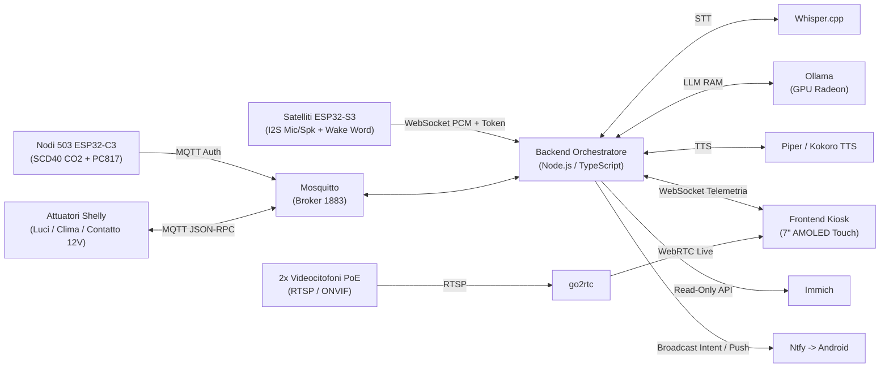

# VEXIS Smart Home (`vexis-smart-home`)

> Sistema domotico, homelab self-hosted e assistente vocale **100% locale, open source e Zero-Cloud**.  
> A **100% local, open-source, Zero-Cloud** smart home, self-hosted homelab, and AI voice assistant.

[**Italiano**](#italiano) · [**English**](#english)

---

## Italiano

[**1. Features**](#1-features) · [**2. Hardware**](#2-hardware) · [**3. Software**](#3-software) · [**4. Extras**](#4-extras)

**Vexis** è progettato per offrire una casa intelligente, reattiva e gestita da un assistente AI locale **senza alcuna dipendenza da cloud esterni** (niente Shelly Cloud, Google Home o app proprietarie):
- **100% Locale:** STT, LLM, TTS, automazioni, videocitofonia, foto e media girano interamente sul server domestico.
- **Privacy & Sicurezza Fisica:** Nessuna serratura smart motorizzata sulle mandate; i portoni blindati sono monitorati con sensori passivi (`PC817` / microswitch) e l'elettroserratura 12V esistente viene gestita esclusivamente **dall'interno**.
- **Identità Vexis:** Wake word locale `Vexis` (+ stop/barge-in), tono asciutto e analitico (stile *Chatty Stick* / *EDI*) e HUD ottico minimale su nero puro AMOLED.

### 1. Features

#### Controllo Domotico & Clima
- **Luci & Stanze:** Comando istantaneo vocale, touch (Kiosk AMOLED) o tramite pulsanti fisici 230V collegati agli Shelly via MQTT JSON-RPC.
- **Termoregolazione:** Gestione a contatto pulito di Caldaia e Chiller basata sulle sonde ambientali (`Shelly BLU H&T` e `SCD40`), con logica fail-safe.
- **Sincronizzazione Sveglia-Luce:** Collegamento automatico tra l'orario della sveglia e l'accensione programmata delle luci al mattino.

#### Qualità dell'Aria (CO₂ Reale NDIR)
- **Monitoraggio Continuo:** Lettura di CO₂ (`ppm`), temperatura e umidità tramite sensori `Sensirion SCD40`.
- **Alert Vocali Mirati:** Avviso vocale sul singolo satellite della stanza interessata sopra i `1200–1300 ppm`, con cooldown anti-spam di 30 minuti e override immediato per picchi critici `>1600 ppm`.
- **Indicatore HUD:** Badge dinamico verde / ambra / rosso sulla dashboard AMOLED e sul display del satellite.

#### Interazione Vocale Multi-Stanza & UX HUD
- **Copertura 5 Stanze & Arbitrazione Anti-Eco:** 5 satelliti `ESP32-S3` integrati negli slot vuoti delle scatole `503` (zero cavi a vista); se due stanze vicine captano la wake word insieme, il backend arbitra entro ~250 ms scegliendo il segnale più forte. Include funzione **Interfono di casa** tra stanze.
- **Doppia Wake Word & Barge-In:** Rilevazione locale su `ESP32-S3` per `Vexis` + parola di interruzione immediata per fermare risposte lunghe o TTS.
- **Memoria Anti-Context-Rot:** Sessioni stateless effimere per stanza (sliding window max 3 turni, TTL 45–60s) con iniezione live dello stato MQTT della casa ad ogni richiesta.
- **Visualizer Ottico AMOLED:** Interfaccia su nero puro `#000000` con nucleo centrale reattivo allo stato (`IDLE`, `LISTENING`, `THINKING`, `SPEAKING`).

#### Videocitofonia Locale (2 Portoni Blindati)
- **Doppio Accesso Indipendente (`door_1` / `door_2`):** Riconoscimento immediato di quale dei due portoni ha suonato, con annuncio vocale mirato sui satelliti `ESP32-S3`.
- **Stream Live & Notifiche:** Apertura automatica della modale video live sul pannello AMOLED tramite `go2rtc` (WebRTC a bassissima latenza, auto-dismiss `60–90s`) + snapshot push su Android via `Ntfy`.
- **Apertura Protetta:** L'elettroserratura 12V esistente è comandabile solo dall'interno (pulsante su Kiosk / pulsante fisico) tramite contatto pulito interno, senza mai esporre fili o relè di apertura sul posto esterno e senza apertura vocale libera.

#### Smartphone Android & Accesso Ospiti
- **Sveglie Vocali (Zero Porte Aperte):** Comandi in linguaggio naturale (es. *"metti una sveglia alle 6:30"* o *"domani faccio il turno di mattina"*) inviati via **Ntfy** come Broadcast Intent nativo Android (`android.intent.action.SET_ALARM` con `SKIP_UI: true`).
- **Link & Percorsi:** Invio rapido di itinerari (Google Maps), promemoria o allerte critiche sullo smartphone.
- **QR Code Ospiti Dinamico:** Proiezione temporanea sul Kiosk di credenziali Wi-Fi Guest o token JWT a scadenza con scope ristretto alle sole luci delle aree comuni (`IDLE` → `LISTENING` → `EXECUTING` → `TEMPORARY_MODAL`, auto-dismiss `60–90s`).

#### Interrogazione Homelab & Media (Ollama Tools)
- **Diagnostica Server:** Controllo vocale di CPU, RAM e spazio libero su NVMe e unità secondaria (`get_system_storage`).
- **Ricerca Semantica Foto (Immich):** Ricerca vocale tramite `/api/search/smart` (API Key **read-only**) e proiezione temporanea sul pannello AMOLED.
- **Musica Lossless & Playlist Vocali (Jellyfin):** Digitalizzazione in **FLAC** della propria collezione di dischi per uso personale, con avvio vocale delle playlist (*"Vexis, avvia la playlist..."*) tramite Jellyfin REST API verso lo stereo (DAC USB / streamer locale) e controlli Play/Pausa + copertina sul pannello AMOLED.
- **Stato Servizi:** Verifica healthcheck dei servizi Homelab (`Jellyfin`, `Vaultwarden`, `Immich`).

### 2. Hardware

| Categoria | Componenti | Ruolo |
| :--- | :--- | :--- |
| **Server & NAS (Rack)** | Mini PC AMD Ryzen 7 (32 GB DDR5 espandibili, **Debian Stable headless**) + **DAS 4-bay USB-C 10 Gbps** (JBOD: `MergerFS + SnapRAID` + backup `Restic/Borg`) + Switch PoE + UPS | Host Docker, modelli AI 7B–8B in RAM, storage media/foto e backup locali |
| **Rete IoT Dedicata** | Access Point dedicato in *AP Mode* (SSID `Vexis-IoT` solo 2.4 GHz su canale separato) | Scarica il Wi-Fi principale dal carico dei 20–30 moduli IoT |
| **Luci (230V AC)** | `Shelly Plus 2PM` / `Shelly 1PM Mini Gen3` + opzione `Shelly Dimmer Gen3` (soggiorno/camera con lampadine dimmerabili) | Controllo luci Zero-Crossing, sequenza 4-stati soggiorno & dimmering graduale |
| **Clima** | `2× Shelly 1 Mini Gen3` (contatto pulito), `1× Shelly BLU H&T Display ZB` | Comando caldaia/chiller e lettura temperatura |
| **Comandi a Muro** | Pulsanti cablati 230V (NA momentanei singoli e doppi `1P+1P`) su scatole `503` *(serie civile in definizione)* | Controllo fisico affidabile + multi-click via Shelly |
| **Pannello Kiosk** | Schermo 7" AMOLED Touch (Chromium fullscreen) | Dashboard HUD, badge CO₂, modali foto/QR/citofono |
| **Satelliti & Sensori (5 Stanze)** | `5× ESP32-S3` (incasso `503` con `Mean Well IRM-05-5` isolato) + `INMP441` + `MAX98357A` + `Sensirion SCD40` (+ `PC817` sui portoni) | All-in-one da incasso: wake word, voce, interfono, CO₂ NDIR e stato portoni |
| **Videocitofonia** | `2× Videocitofoni IP PoE` *(modello in definizione, RTSP/ONVIF/SIP, senza NFC)* | Video/audio locale sui 2 portoni blindati |

### 3. Software



Orchestrato in [`docker/docker-compose.yml`](docker/docker-compose.yml) con policy `restart: unless-stopped` e reti bridge isolate (`vexis-core`, `vexis-media`, `vexis-proxy`):
- **Mosquitto:** Broker MQTT locale su porta `1883` (`allow_anonymous false`, ACL, *Retained Messages*, *LWT*).
- **Ollama:** LLM locale (`qwen2.5:7b` / `llama3.1:8b`) residente in RAM (`OLLAMA_KEEP_ALIVE=-1`) con GPU Radeon (`/dev/kfd`, `/dev/dri`).
- **Whisper.cpp & Piper TTS:** Pipeline locale Speech-to-Text e Text-to-Speech.
- **go2rtc:** Bridge locale `RTSP`/`ONVIF` → `WebRTC` per i due videocitofoni verso il Kiosk.
- **Ntfy:** Push notification locale verso Android.
- **Backend (`backend/`) & Frontend (`frontend/`):** Node.js/TypeScript non-root (`zod`, MQTT JSON-RPC, WS autenticato) + React/Tailwind su `nginx-unprivileged`.

<details>
<summary><strong>Struttura della Repository & Avvio Rapido</strong></summary>

```text
vexis-smart-home/
├── .env.example               # Template pubblico variabili d'ambiente
├── .gitignore                 # Esclusione segreti, password MQTT, volumi e pesi AI
├── ARCHITECTURE.md            # Specifiche tecniche e modello di sicurezza
├── CONTEX.MD                  # Documento di specifica del progetto
├── README.md                  # Documentazione (IT / EN)
├── docker/
│   ├── docker-compose.yml     # Stack unificato (Domotica + AI + Homelab)
│   └── mosquitto/
│       ├── mosquitto.conf     # Configurazione broker MQTT (no anonymous)
│       └── acl.conf           # Controllo accessi topic MQTT
├── backend/                   # Orchestratore Node.js / TypeScript
├── frontend/                  # Dashboard Kiosk 7" AMOLED (React + Tailwind)
└── firmware/
    ├── satellite-esp32s3/     # Firmware PlatformIO satellite vocale ESP32-S3
    └── sensor-esp32c3/        # Firmware PlatformIO nodo sensori 503 ESP32-C3
```

```bash
# 1. Configura .env
cp .env.example .env

# 2. Genera le credenziali Mosquitto
docker run --rm -v $(pwd)/docker/mosquitto:/mosquitto/config eclipse-mosquitto:2.0 \
  mosquitto_passwd -c -b /mosquitto/config/passwd vexis_orchestrator "<MQTT_PASSWORD>"

# 3. Avvia lo stack Docker
docker compose -f docker/docker-compose.yml --env-file .env up -d
```

Per i moduli ESP32 in `firmware/`, copia `include/config.h.example` in `include/config.h` e compila con PlatformIO.

</details>

### 4. Extras
- **Servizi Homelab:** **Immich** (foto/video + ricerca CLIP read-only), **Jellyfin** (film, serie TV e musica **FLAC** + app come *Finamp*), **Vaultwarden**, **Nginx Proxy Manager** (`*.home`, admin su `127.0.0.1:81`), **Portainer** (`docker.sock:ro`).
- **Sicurezza & Hardening:** Container non-root, nessun `privileged: true`, validazione strict delle env. Dettagli in [`ARCHITECTURE.md`](ARCHITECTURE.md).
- **Decisioni Aperte (Brainstorming):** serie civile pulsanti 230V (`503`), modello definitivo videocitofoni PoE (senza NFC), dimmerazione LED (`Shelly Dimmer Gen3`), eventuale upgrade futuro a 64 GB DDR5 / eGPU via OCuLink/USB4.

---

## English

[**1. Features**](#1-features-en) · [**2. Hardware**](#2-hardware-en) · [**3. Software**](#3-software-en) · [**4. Extras**](#4-extras-en)

**Vexis** is built to deliver a responsive, AI-powered smart home **with zero external cloud dependencies** (no Shelly Cloud, no Google Home, no proprietary apps):
- **100% Local:** STT, LLM, TTS, automations, video intercom, photos, and media all run strictly on your home server.
- **Physical Privacy & Security:** No motorized smart locks on armored deadbolts; armored doors are monitored via passive isolated sensors (`PC817` optoisolator / microswitch), and the existing 12V electric latch is controlled exclusively **from inside the house**.
- **Vexis Identity:** Local wake word `Vexis` (+ immediate stop/barge-in), dry analytical slightly cynical/mecha tone (*Chatty Stick* / *EDI* style), and a minimalist optical HUD on pure AMOLED black.

### 1. Features (EN)

#### Home Automation & Climate
- **Lights & Rooms:** Instant control via voice, AMOLED Kiosk touch UI, or wired 230V wall push-buttons connected to Shelly relays over local MQTT JSON-RPC.
- **Climate Control:** Dry-contact boiler and chiller control based on environmental sensors (`Shelly BLU H&T` and `SCD40`), with software/hardware fail-safes.
- **Alarm-to-Light Sync:** Automatically links morning alarms to scheduled or gradual wake-up lighting.

#### Air Quality Monitoring (True NDIR CO₂)
- **Continuous Sensing:** Real-time CO₂ (`ppm`), temperature, and humidity readings via `Sensirion SCD40` sensors.
- **Targeted Voice Alerts:** Spoken warning exclusively on the affected room's satellite above `1200–1300 ppm`, with a 30-minute anti-spam cooldown and immediate override on critical spikes (`>1600 ppm`).
- **HUD Indicator:** Dynamic green / amber / red status badge on the AMOLED dashboard and satellite display.

#### Multi-Room Voice Interaction & HUD UX
- **5-Room Coverage & Anti-Echo Arbitration:** 5 flush-mounted `ESP32-S3` satellites hidden inside unused Italian `503` wall-box slots (zero visible cables); when adjacent rooms hear the wake word simultaneously, the backend arbitrates within ~250 ms and picks the strongest signal. Includes a **room-to-room intercom** feature.
- **Dual Wake Word & Barge-In:** Local `ESP32-S3` detection for `Vexis` + an instant stop word to interrupt long replies or active TTS playback.
- **Anti-Context-Rot Memory:** Ephemeral stateless per-room LLM sessions (sliding window max 3 turns, 45–60s TTL) with live MQTT home state injected into every prompt.
- **AMOLED Optical Visualizer:** Pure `#000000` UI with a reactive central optical core (`IDLE`, `LISTENING`, `THINKING`, `SPEAKING`).

#### Local Video Intercom (2 Armored Doors)
- **Dual Independent Entrances (`door_1` / `door_2`):** Instantly identifies which door rang, triggering targeted voice announcements on the `ESP32-S3` satellites.
- **Live Stream & Push Alerts:** Automatically opens a temporary live video modal on the 7" AMOLED Kiosk via `go2rtc` (low-latency WebRTC, `60–90s` auto-dismiss) and sends a snapshot push notification to Android via `Ntfy`.
- **Protected Door Release:** The existing 12V electric latch can only be triggered from inside (Kiosk button / indoor physical switch) via an indoor dry-contact relay—never exposing lock wiring outside and never allowing unauthenticated voice unlocking.

#### Android Integration & Guest Access
- **Voice Alarms (Zero Open Ports):** Natural-language commands (e.g., *"set an alarm for 6:30"* or *"I have the morning shift tomorrow"*) pushed via **Ntfy** as native Android Broadcast Intents (`android.intent.action.SET_ALARM` with `SKIP_UI: true`).
- **Links & Navigation:** Send Google Maps routes, reminders, or urgent alerts straight to Android.
- **Dynamic Guest QR Code:** Temporarily displays Guest Wi-Fi credentials or a short-lived scoped JWT limited strictly to common-area lights (`IDLE` → `LISTENING` → `EXECUTING` → `TEMPORARY_MODAL`, `60–90s` auto-dismiss).

#### Homelab & Media Control (Ollama Tools)
- **Server Diagnostics:** Voice queries for Mini PC CPU, RAM, and disk usage across NVMe and secondary storage (`get_system_storage`).
- **Semantic Photo Search (Immich):** Voice search via `/api/search/smart` (using a **read-only** API key) with temporary carousel projection on the 7" AMOLED panel.
- **Lossless Music & Voice Playlists (Jellyfin):** Personal CD collection ripped to **FLAC**, with voice-triggered playlist playback (*"Vexis, start my playlist..."*) via Jellyfin REST API to the home stereo (USB DAC / local streamer) plus album art and Play/Pause controls on the Kiosk.
- **Service Health:** Query health status of Homelab services (`Jellyfin`, `Vaultwarden`, `Immich`).

### 2. Hardware (EN)

| Category | Components | Role |
| :--- | :--- | :--- |
| **Server & Rack NAS** | AMD Ryzen 7 Mini PC (32 GB expandable DDR5, **Debian Stable headless**) + **4-bay USB-C 10 Gbps DAS** (JBOD: `MergerFS + SnapRAID` + `Restic/Borg` backups) + PoE Switch + UPS | Docker host, 7B–8B local LLM in RAM, media/photo storage & local backups |
| **Dedicated IoT Wi-Fi** | Dedicated Access Point in *AP Mode* (`Vexis-IoT` 2.4 GHz SSID on a separate channel) | Offloads 20–30 IoT clients from the main home Wi-Fi |
| **Lighting (230V AC)** | `Shelly Plus 2PM` / `Shelly 1PM Mini Gen3` + optional `Shelly Dimmer Gen3` (living room/bedroom with dimmable LEDs) | Zero-crossing switching, 4-step living room script & gradual dimming |
| **Climate** | `2× Shelly 1 Mini Gen3` (dry contact), `1× Shelly BLU H&T Display ZB` | Boiler/chiller control & ambient temperature sensing |
| **Wall Controls** | Wired 230V momentary push-buttons (single & dual `1P+1P`) in `503` boxes *(switch series TBD)* | Zero-battery physical control + multi-click actions via Shelly |
| **Kiosk Panel** | 7" AMOLED Touch Display (Chromium fullscreen kiosk) | HUD dashboard, CO₂ badges, photo/QR/intercom modals |
| **Satellites & Sensors (5 Rooms)** | `5× ESP32-S3` (flush-mounted in `503` with isolated `Mean Well IRM-05-5`) + `INMP441` + `MAX98357A` + `Sensirion SCD40` (+ `PC817` on doors) | All-in-one flush module: wake word, voice, intercom, NDIR CO₂ & door state |
| **Video Intercom** | `2× PoE IP Video Doorbells` *(model TBD, local RTSP/ONVIF/SIP, no NFC)* | Local video/audio for both armored entrance doors |

### 3. Software (EN)
Orchestrated in [`docker/docker-compose.yml`](docker/docker-compose.yml) with `restart: unless-stopped` and isolated bridge networks (`vexis-core`, `vexis-media`, `vexis-proxy`):
- **Mosquitto:** Local MQTT broker on port `1883` (`allow_anonymous false`, ACLs, *Retained Messages*, *LWT*).
- **Ollama:** Local LLM runtime (`qwen2.5:7b` / `llama3.1:8b`) pinned in RAM (`OLLAMA_KEEP_ALIVE=-1`) with Radeon GPU acceleration (`/dev/kfd`, `/dev/dri`).
- **Whisper.cpp & Piper TTS:** Low-latency local Speech-to-Text and Text-to-Speech pipeline.
- **go2rtc:** Ultra-low-latency local `RTSP`/`ONVIF` → `WebRTC` video bridge to the AMOLED Kiosk.
- **Ntfy:** Self-hosted push notifications for Android intents and alerts.
- **Backend (`backend/`) & Frontend (`frontend/`):** Non-root Node.js/TypeScript orchestrator (`zod`, MQTT JSON-RPC, authenticated WS) + React/Tailwind served via `nginx-unprivileged`.

<details>
<summary><strong>Quick Start</strong></summary>

```bash
# 1. Configure .env
cp .env.example .env

# 2. Generate Mosquitto credentials
docker run --rm -v $(pwd)/docker/mosquitto:/mosquitto/config eclipse-mosquitto:2.0 \
  mosquitto_passwd -c -b /mosquitto/config/passwd vexis_orchestrator "<MQTT_PASSWORD>"

# 3. Start the Docker stack
docker compose -f docker/docker-compose.yml --env-file .env up -d
```

For the ESP32 firmware in `firmware/`, copy `include/config.h.example` to `include/config.h` and build with PlatformIO.

</details>

### 4. Extras (EN)
- **Additional Homelab Services:** **Immich** (photo/video backup & CLIP read-only search), **Jellyfin** (movies, TV & **FLAC** music + *Finamp* client support), **Vaultwarden**, **Nginx Proxy Manager** (`*.home`, admin bound to `127.0.0.1:81`), **Portainer** (`docker.sock:ro`).
- **Security & Hardening:** Non-root containers, zero `privileged: true`, strict fail-fast env validation. See [`ARCHITECTURE.md`](ARCHITECTURE.md).
- **Open Decisions (Phase 2 Brainstorming):** 230V wall switch series (`503`), PoE video doorbell model (no NFC), LED dimming (`Shelly Dimmer Gen3`), and future 64 GB DDR5 / OCuLink eGPU AI upgrade path.
